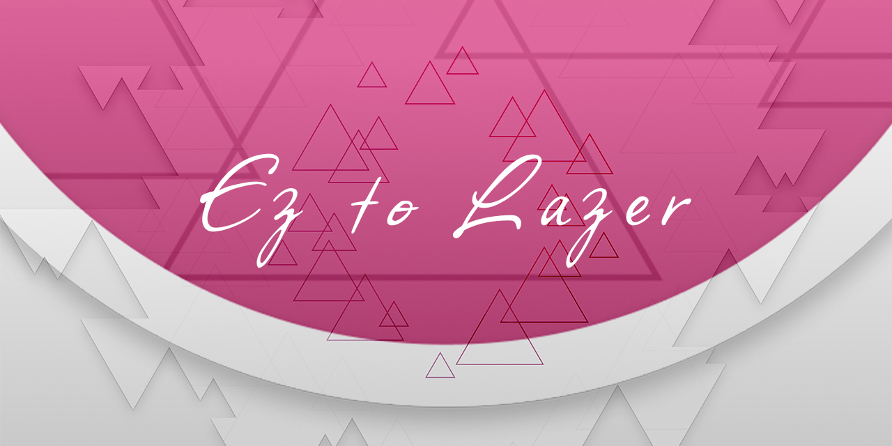

# Ez2Lazer Neri_Edge

基于 [SK-la/Ez2Lazer](https://github.com/SK-la/Ez2Lazer) 的分支，保留上游 EzHUDLeaderboard 等全部功能，额外整合了 KazamataNeri-Love 的特色定制功能。

---

## ✨ Neri_Edge 特色功能

### 一、设置层面

#### 设置预设

把一整组 Ez 设置保存为可命名的预设，随时加载、覆盖或删除，入口在「设置 → 通用 → 快捷设置」。

- 预设字段由 `EzSettingsPresetCatalog` 定义，序列化为 `EzSettingsPresetDocument` 落到 `EzSettingsPresetStore`
- `EzSettingsPresetControl` 提供保存 / 加载 / 编辑 / 删除界面，`EditSettingsPresetPopover` 负责命名与覆盖确认
- `EzSettingsPresetBridge` 负责把预设值写回 `Ez2ConfigManager` 与 `OsuConfigManager`

**涉及文件：**
- `osu.Game/EzOsuGame/Presets/`（`EzSettingsPresetControl` / `Bridge` / `Catalog` / `Document` / `Store` / `EditSettingsPresetPopover`）
- `osu.Game/Overlays/Settings/Sections/General/QuickActionSettings.cs`

#### 自定义光标

菜单光标可改用皮肤提供的光标贴图，并支持可选的拖尾效果；皮肤未提供时自动回退默认光标。开关位于「设置 → 自定义」。

- 皮肤光标：`EzSkinCursor`；拖尾：`EzCursorTrail` / `EzLegacyCursorTrail`
- 挂载与回退逻辑在 `MenuCursorContainer`，配置项为 `Ez2Setting.UseSkinCursor`

**涉及文件：**
- `osu.Game/Graphics/Cursor/EzSkinCursor.cs`
- `osu.Game/Graphics/Cursor/EzCursorTrail.cs`
- `osu.Game/Graphics/Cursor/EzLegacyCursorTrail.cs`
- `osu.Game/Graphics/Cursor/MenuCursorContainer.cs`

#### 从头播放音频

选歌预览从音频开头（0ms）播放，忽略谱面的 `PreviewTime`；切换难度时若音频未变，不打断当前播放，仅重建判定音调度表。开关位于「设置 → 自定义」。

**涉及文件：**
- `osu.Game/Screens/Select/SongSelect.cs`
- `osu.Game/EzOsuGame/Audio/EzPreviewTrackManager.cs`

#### 设置页「自定义」栏目

设置侧栏最底部新增独立的「自定义」页（`EzCustomSection` → `EzCustomSettings`），用于收纳不属于任何上游分组的 Ez 开关，目前承载「使用皮肤光标」与「从头播放音频」两项。

**涉及文件：**
- `osu.Game/EzOsuGame/Overlays/EzCustomSection.cs`
- `osu.Game/EzOsuGame/Overlays/EzCustomSettings.cs`
- `osu.Game/Overlays/Settings/EzSettingsSectionDivider.cs`
- `osu.Game/Overlays/SettingsOverlay.cs`

---

### 二、容器层面

#### 独立音乐播放器界面

脱离选歌流程的独立音乐播放页，包含封面、曲目信息、播放控制与播放列表面板。

| 文件 | 职责 |
|---|---|
| `EzMusicPlayerScreen.cs` | 页面入口与整体布局 |
| `EzMusicPlayerCover.cs` | 封面展示 |
| `EzMusicPlayerInfo.cs` | 曲目信息 |
| `EzMusicPlayerControls.cs` | 播放控制 |
| `EzMusicPlayerPlaylistPanel.cs` | 播放列表面板 |
| `EzMusicPlayerLayoutDefaults.cs` | 默认布局参数 |

**目录：** `osu.Game/EzOsuGame/Screens/MusicPlayer/`

#### 新增皮肤容器槽位

`GlobalSkinnableContainers` 新增两个容器枚举，使多处界面可被皮肤定制：

| 容器 | 说明 |
|---|---|
| **Background** | 「Background 皮肤组件图层」的皮肤落点，组件渲染在游戏内容之下 |
| **MusicPlayer** | 音乐播放器界面的皮肤容器，可定制播放器布局 |

**涉及文件：**
- `osu.Game/Skinning/GlobalSkinnableContainers.cs`
- `osu.Game/Skinning/SkinnableContainer.cs`、`osu.Game/Skinning/TrianglesSkin.cs`

---

### 三、组件层面

| 组件 | 说明 | 位置 |
|---|---|---|
| **音频可视化 HUD** | 运行时音频频谱/波形可视化，可作为皮肤组件放进 HUD 布局 | `osu.Game/EzOsuGame/HUD/EzAudioVisualiser.cs`、`EzAudioVisualiserScale.cs` |
| **DJMAX 连击 HUD** | DJMAX 风格的 Mania 连击显示 | `osu.Game.Rulesets.Mania/EzMania/HUD/EzHUDComboCounterDJMAX.cs` |
| **NeriBoxElement** | Ez HUD 的盒子底板元素，可被皮肤编辑器放置与调参 | `osu.Game/EzOsuGame/HUD/NeriBoxElement.cs` |
| **300G 率计数器** | 统计 Perfect/Great 的 300G 比率；默认皮肤与 Legacy 皮肤各一套 | `osu.Game/Screens/Play/HUD/Default300GRateCounter.cs`、`osu.Game/Skinning/Legacy300GRateCounter.cs` |
| **Legacy 判定计数** | Legacy 风格的判定分布计数器（含显示层） | `osu.Game/Screens/Play/HUD/JudgementCounter/LegacyJudgementCounter.cs`、`LegacyJudgementCounterDisplay.cs` |

---

### 四、模组层面

#### 置顶 Mod

可将常用 Mod 固定到 Mod 选择界面的独立置顶列，跨会话保留。

- 右键任意 Mod 选择「置顶 / 取消置顶」，配置项为 `Ez2Setting.PinnedMods`
- 置顶列由 `PinnedModColumn` / `PinnedModPanel` 渲染，状态与排序由 `EzPinnedModsController` 管理

**涉及文件：**
- `osu.Game/Overlays/PinnedModColumn.cs`
- `osu.Game/Overlays/PinnedModPanel.cs`
- `osu.Game/EzOsuGame/UserInterface/EzPinnedModsController.cs`
- `osu.Game/Overlays/Mods/ModSelectOverlay.cs`
- `osu.Game/Overlays/Mods/ModPanel.cs`

#### Neri Mod 系列

在 Mod 选择界面新增 **NeriMod** 分类列（橙色标识），包含以下定制 Mod：

##### Mania NeriMods

| Mod | 说明 |
|---|---|
| **ManiaModNeriBarrelRoll** | Barrel Roll — 谱面水平翻转滚动 |
| **ManiaModNeriFasterBarrelRoll** | Faster Barrel Roll — 加速版 Barrel Roll |
| **ManiaModNeriDance** | Dance — 谱面舞蹈式左右摆动 |
| **ManiaModNeriNewDance** | New Dance — 新版 Dance 效果 |
| **ManiaModSlantCompensation** | Slant Compensation — 斜向 Note 的尺寸补偿 |

##### Osu NeriMods

| Mod | 说明 |
|---|---|
| **OsuModFasterBarrelRoll** | Osu 版 Faster Barrel Roll |
| **OsuModNeriHidden** | Neri 版 Hidden（隐球） |

##### 基础架构
- `ModType.cs` 新增 `NeriMod = 8` 枚举
- `OsuColour.cs` 中 NeriMod 映射为橙色 (`Orange1`)
- `ModSelectOverlay.cs` 新增 NeriMod 列

**涉及文件：**
- `osu.Game.Rulesets.Mania/EzMania/Mods/LAsMods/ManiaModNeri*.cs`
- `osu.Game.Rulesets.Mania/EzMania/Mods/LAsMods/ManiaModSlantCompensation.cs`
- `osu.Game.Rulesets.Mania/EzMania/Mods/LAsMods/SlantNoteCompensator.cs`
- `osu.Game.Rulesets.Osu/Mods/OsuModFasterBarrelRoll.cs`
- `osu.Game.Rulesets.Osu/Mods/OsuModNeriHidden.cs`
- `osu.Game.Rulesets.Mania/ManiaRuleset.cs`
- `osu.Game.Rulesets.Osu/OsuRuleset.cs`
- `osu.Game/Rulesets/Mods/ModType.cs`
- `osu.Game/Graphics/OsuColour.cs`
- `osu.Game/Overlays/Mods/ModSelectOverlay.cs`

#### Mod 选择界面去斜切

取消 Mod 卡片与预设列原本的斜切（Shear）样式，并相应调整卡片高度与内外间距，使 Mod 选择界面的观感与其它界面一致。

**涉及文件：**
- `osu.Game/Overlays/Mods/ModColumn.cs`
- `osu.Game/Overlays/Mods/ModSelectColumn.cs`
- `osu.Game/Overlays/Mods/ModSelectPanel.cs`
- `osu.Game/Overlays/Mods/ModPresetColumn.cs`
- `osu.Game/Overlays/Mods/ModPresetPanel.cs`
- `osu.Game/Overlays/Mods/AddPresetButton.cs`
- `osu.Game/Rulesets/UI/ModSwitchSmall.cs`

---

### 五、其他

#### 背景缩放 / 位置

在图形设置的布局选项中新增三个滑块，可独立调节游戏背景画面（背景图 / 故事板 / 视频）的缩放和位移：

| 设置项 | 范围 | 说明 |
|---|---|---|
| 背景缩放 (Background scale) | 0.50 ~ 1.00 | 以屏幕中心为基准缩放 |
| 水平位置 (Horizontal position) | 0% ~ 100% | 缩放后的水平偏移百分比 |
| 垂直位置 (Vertical position) | 0% ~ 100% | 缩放后的垂直偏移百分比 |

- 缩放以屏幕中心为锚点，图像从中心向外收缩/放大
- 位移量随缩放比例自动适配，缩放越小可移动范围越大
- 调节时有实时预览层，松手后自动淡出

**涉及文件：**
- `osu.Game/Screens/Play/DimmableStoryboard.cs`
- `osu.Game/Overlays/Settings/Sections/Graphics/LayoutSettings.cs`
- `osu.Game/EzOsuGame/Configuration/Ez2ConfigManager.cs`
- `osu.Game/EzOsuGame/Localization/EzSettingsStrings.cs`

#### Background 皮肤组件图层

为规则集游玩界面添加了一个独立的背景渲染层 `BackgroundLayer`，位于所有游戏内容之下：

- 不受 `FrameStabilityContainer` 的时间稳定性影响
- 支持皮肤编辑器发现和皮肤组件加载
- 通过 `SkinnableContainer.ExternalTarget` 代理机制，将皮肤组件渲染到独立容器
- 可用于放置舞台背景、动态光效等不参与游戏判定的纯视觉元素

**涉及文件：**
- `osu.Game/Rulesets/UI/DrawableRuleset.cs`
- `osu.Game/Skinning/SkinnableContainer.cs`
- `osu.Game/Skinning/GlobalSkinnableContainers.cs`
- `osu.Game/Skinning/TrianglesSkin.cs`

#### 故事板筛选

选歌筛选栏新增「有视频 / 故事板」开关，只显示带视频或故事板的谱面，可与其它筛选条件叠加。

**涉及文件：**
- `osu.Game/Screens/Select/FilterControl.cs`
- `osu.Game/Screens/Select/FilterCriteria.cs`

#### 规则集循环切换

新增 `Ctrl+Tab` 循环切换规则集（最后一个之后回到第一个），与工具栏 `Ctrl+数字` 直选共用同一份规则集列表和音效行为；游玩 / 编辑中不响应。

**涉及文件：**
- `osu.Game/EzOsuGame/Input/EzRulesetCycleHelper.cs`
- `osu.Game/Input/Bindings/GlobalActionContainer.cs`
- `osu.Game/OsuGame.cs`
- `osu.Game.Tests/NonVisual/EzRulesetCycleTest.cs`

#### 主菜单 Ez LOGO

在主菜单 `OsuLogo` 之上叠加 Ez 自己的可视化与装饰层：频谱可视化、背板光晕、中心文字，并用菜单背景图取色驱动配色。

**涉及文件：**
- `osu.Game/EzOsuGame/Screens/Menu/EzMenuLogoVisualisation.cs`
- `osu.Game/EzOsuGame/Screens/Menu/EzMenuLogoBackdrop.cs`
- `osu.Game/EzOsuGame/Screens/Menu/EzMenuLogoCentreText.cs`
- `osu.Game/EzOsuGame/Screens/Menu/EzLogoBackdropSampler.cs`

#### 播放列表收藏夹过滤

音乐播放器的播放列表面板支持限定到某个收藏夹，只列出该收藏夹内的谱面。

**涉及文件：**
- `osu.Game/Overlays/Music/PlaylistOverlay.cs`

---

### 附：OsuLogo 配色定制

主菜单 Logo 配色从默认粉色调整为蓝色主题：

| 元素 | 原色 | Neri 色 |
|---|---|---|
| 背景圆盘 | `#ff66ab → #cc5289` | `#1A2B6B → #4A7DD0` |
| 三角形斑纹 | `#ff66ab → #b6346f` | `#1A2B6B → #3A6BB8` |

**涉及文件：**
- `osu.Game/Screens/Menu/OsuLogo.cs`

---

### 附：上游合并功能 (ppy/osu 移植)

| 功能 | 来源 | 说明 |
|---|---|---|
| **LegacySkinEncoder** | ppy/osu #38090 | 完整的 `skin.ini` 编码器，支持皮肤重命名持久化；`BarLineHeight` 默认值修正为 1.2f；新增 `SpecialStyle`/`UpsideDown`/`SplitStages` 等参数的编解码保留 |
| **Kiai time 修复** | ppy/osu #38107 | 修复 Legacy 谱面编码器在首个控制点错误输出 kiai time 标志的问题 |

---

## 🔧 构建与运行

```bash
# Release 构建
dotnet build osu.Desktop/osu.Desktop.csproj -c Release

# 直接运行
./osu.Desktop/bin/Release/net8.0/Ez2osu!.exe
```


## 🌐 仓库

- **上游主分支：** [SK-la/Ez2Lazer](https://github.com/SK-la/Ez2Lazer)
- **Neri Edge：** [KazamataNeri-Love/Ez2Lazer/tree/Edge](https://github.com/KazamataNeri-Love/Ez2Lazer/tree/Edge)
- **功能分支：** `Storyboard-Scale` / `Background-Container` / `Neri-Mod`


# Ez2Lazer 介绍

<p align="center">
  
</p>

<div align="center">
    <a href="https://github.com/SK-la/Ez2Lazer/releases" target="_blank"></a>  
    <a href="https://github.com/SK-la/Ez2Lazer/wiki" target="_blank"></a>
    <a href="https://github.com/SK-la/Ez2Lazer" target="_blank"></a>
    <a href="https://github.com/SK-la/ez2lazer-framework" target="_blank"></a>
    <a href="https://github.com/SK-la/ez2lazer-resources" target="_blank"></a>
    <a href="https://space.bilibili.com/4100834" target="_blank"></a>

</div>

<div align="center">

[**English**](README.md) | [中文](README.zh-CN.md)

</div>

# Ez2Lazer

Ez2Lazer is a heavily customized branch based on osu! lazer, focused on Mania/BMS workflows, configurable HUD, switchable judgement systems and analysis tools.

## Licence

Ez2Lazer is based on [osu!](https://github.com/ppy/osu), licensed under the [MIT licence](https://opensource.org/licenses/MIT).  
See [LICENCE](LICENCE) for details. Upstream copyright remains with ppy Pty Ltd; Ez2Lazer modifications are by SK-la.

This does not cover usage of "osu!" or "ppy" branding, which is protected by trademark law.  
Game resources are covered by a separate licence in [ppy/osu-resources](https://github.com/ppy/osu-resources).

## Download and Run

- Latest releases: [SK-la/Ez2Lazer Releases](https://github.com/SK-la/Ez2Lazer/releases)
- Resource pack: [EzResources (OneDrive)](https://1drv.ms/f/c/f3cc2de32b3b7226/IgBk_21pXWxGS68n3ucCBC5lAappj0tXAeQAUBnNG1eWki0?e=nTkpPz)
- Runtime: [.NET 10 Desktop Runtime](https://dotnet.microsoft.com/download/dotnet/10.0)

**Auto-update (recommended)**  
- Windows: use `ez2lazer-win-Setup.exe` from Releases (requires [.NET 10 Desktop Runtime](https://dotnet.microsoft.com/download/dotnet/10.0)); in-game updates download deltas afterward.  
- For manual installs use `Ez2Lazer_release_*.zip`; zip installs cannot receive delta updates until you switch to Setup once.

> Without EzResources, Ez Pro Skin and Ez HUD widgets will miss textures.

## Documentation

The full documentation now lives in Wiki; this README stays as a quick index.

- Home: [Ez2Lazer Wiki](https://github.com/SK-la/Ez2Lazer/wiki)
- Overview: [Feature Overview](https://github.com/SK-la/Ez2Lazer/wiki/Feature-Overview-English)

### Feature Areas
- [Song Select](https://github.com/SK-la/Ez2Lazer/wiki/Song-Select-English)
- [Game Settings](https://github.com/SK-la/Ez2Lazer/wiki/Game-Settings-English)
- [Skin System](https://github.com/SK-la/Ez2Lazer/wiki/Skin-System-English)
- [Mod System](https://github.com/SK-la/Ez2Lazer/wiki/Mod-System-English)
- [HUD Widgets](https://github.com/SK-la/Ez2Lazer/wiki/HUD-Widgets-English)
- [Editor](https://github.com/SK-la/Ez2Lazer/wiki/Editor-English)
- [Judgement and Health](https://github.com/SK-la/Ez2Lazer/wiki/Judgement-and-Health-English)

## Quick Setup

1. Download the program and extract it to any folder.
2. In settings, use `Change folder location` to point at your data path.
3. Download and extract EzResources into that path (so it sits at `.../EzResources`).

Full steps: [Installation Guide](https://github.com/SK-la/Ez2Lazer/wiki/Installation-Guide-(English))

## Build Instructions

```bash
git clone https://github.com/SK-la/Ez2Lazer
git clone https://github.com/SK-la/ez2lazer-framework
git clone https://github.com/SK-la/ez2lazer-resources
```

Versions of `ez2lazer.Framework` and `ez2lazer.Game.Resources` are maintained in [Ez2Lazer.Dependencies.props](Ez2Lazer.Dependencies.props).

To use local sibling projects during development, toggle the two switches independently:
- `<UseEz2LazerLocalFrameworkProject>true</UseEz2LazerLocalFrameworkProject>` / `-p:UseEz2LazerLocalFrameworkProject=true`
- `<UseEz2LazerLocalResourcesProject>true</UseEz2LazerLocalResourcesProject>` / `-p:UseEz2LazerLocalResourcesProject=true`

Set the matching switch back to `false` to return to the NuGet reference.

Self-built copies hide in-game update settings and do not check SK-la/Ez2Lazer Releases for updates.

## Special Thanks
- [osu!](https://github.com/ppy/osu): The original game and framework.
- [YuLiangSSS](https://osu.ppy.sh/users/15889644): Contributed many fun mods.
- [g0v0](https://github.com/GooGuTeam/g0v0-server): Private server support.
- [mania-hub](https://github.com/aleju03/mania-hub): Data display inspiration.
- [MinaCalc](https://github.com/etternagame/etterna): Skill algorithm.
