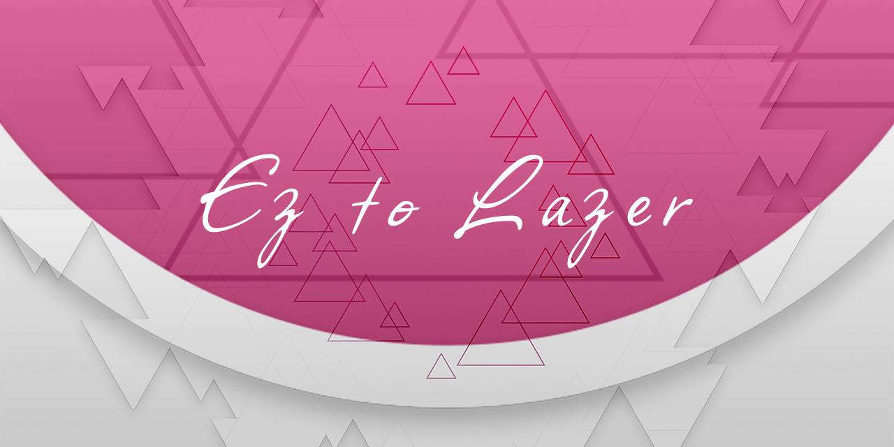

# Ez2Lazer Neri_Edge

基于 [SK-la/Ez2Lazer](https://github.com/SK-la/Ez2Lazer) 的 `Edge` 分支。上游功能（HUD 体系、Mod、皮肤、Ez Pro、BMS 等）全部保留；本页只记录**本分支相对上游 `skla/master` 的差异**，上游共有的功能请查 [上游 Wiki](https://github.com/SK-la/Ez2Lazer/wiki)。

> 对账基线：2026-11-20 的 `skla/master`（`a312a7feea`），差异共 250 个文件（`+13781 / −8499`）。上游继续前进后，以 `git diff skla/master Edge` 的实际结果为准。

---

## 一、设置

### 设置预设

把一整组 Ez 设置保存为可命名的预设，随时加载、覆盖或删除。入口在「设置 → 通用 → 快捷设置」。

- 预设字段由 `EzSettingsPresetCatalog` 定义，序列化为 `EzSettingsPresetDocument` 落到 `EzSettingsPresetStore`
- `EzSettingsPresetControl` 提供保存 / 加载 / 编辑 / 删除界面，`EditSettingsPresetPopover` 负责命名与覆盖确认
- `EzSettingsPresetBridge` 把预设值写回 `Ez2ConfigManager` 与 `OsuConfigManager`
- Mania 的规则集设置经 `EzSettingsPresetRulesets` 单独桥接（规则集设置类型定义在规则集程序集，这里只走 `IRulesetConfigCache` 通用通道），因此预设可以跨规则集保存与恢复

**涉及文件：**
- `osu.Game/EzOsuGame/Presets/`（`EzSettingsPresetControl` / `Bridge` / `Catalog` / `Document` / `Store` / `Rulesets` / `EditSettingsPresetPopover`）
- `osu.Game/Overlays/Settings/Sections/General/QuickActionSettings.cs`

### 从头播放音频

选歌预览从音频开头（0ms）播放，忽略谱面的 `PreviewTime`。开关位于「设置 → 自定义」。

- 切难度时用 `BeatmapInfo.AudioEquals` 判断音频是否真的变化：同音频不打断当前播放，只重建判定音调度表；音频变化才 seek 到 0
- 全屏预览会铺满屏幕，此时隐藏游戏级 Ez 布局层的选歌 HUD，避免被遮挡

**涉及文件：**
- `osu.Game/Screens/Select/SongSelect.cs`
- `osu.Game/EzOsuGame/Audio/EzPreviewTrackManager.cs`

### 设置页「自定义」栏目

设置侧栏最底部新增独立的「自定义」页（`EzCustomSection` → `EzCustomSettings`），收纳不属于任何上游分组的 Ez 开关，目前承载「从头播放音频」。

**涉及文件：**
- `osu.Game/EzOsuGame/Overlays/EzCustomSection.cs`
- `osu.Game/EzOsuGame/Overlays/EzCustomSettings.cs`
- `osu.Game/Overlays/Settings/EzSettingsSectionDivider.cs`
- `osu.Game/Overlays/SettingsOverlay.cs`

### 背景缩放 / 位置

图形设置的布局选项新增三个滑块，独立调节游戏背景画面（背景图 / 故事板 / 视频）的缩放与位移：

| 设置项 | 范围 | 说明 |
|---|---|---|
| 背景缩放 (Background scale) | 0.10 ~ 1.00 | 以屏幕中心为基准缩放 |
| 水平位置 (Horizontal position) | 0% ~ 100% | 缩放后的水平偏移百分比 |
| 垂直位置 (Vertical position) | 0% ~ 100% | 缩放后的垂直偏移百分比 |

- 背景层与 `DimmableStoryboard` 共用一个缩放包装层，两者同步缩放、同步暗化，故事板缺失时背景图仍吃同一套变换
- 位移量随缩放比例自动适配，缩放越小可移动范围越大；背景按 Fit 完整显示而不是裁切

**涉及文件：**
- `osu.Game/Screens/Play/Player.cs`
- `osu.Game/Screens/Play/DimmableStoryboard.cs`
- `osu.Game/Overlays/Settings/Sections/Graphics/LayoutSettings.cs`
- `osu.Game/EzOsuGame/Configuration/Ez2ConfigManager.cs`
- `osu.Game/EzOsuGame/Localization/EzSettingsStrings.cs`

---

## 二、身份与成绩

### 本地账户名接管

开关打开后，一切「我是谁」以本地账户名为准：成绩署名、HUD 与结算显示名、本地档案分区都用这个名字；在线连接只保留下载等只读用途，不上传成绩、不做在线拉取。

- 刻意不影响：API 鉴权与请求身份、在线排行榜、聊天与好友、在线状态、联机、收藏——那些属于网络会话身份
- 关闭时完全按登录的在线账号走，与上游一致

**涉及文件：**
- `osu.Game/EzOsuGame/Identity/EzLocalIdentity.cs`
- `osu.Game/EzOsuGame/Identity/EzLocalAccountNameDialog.cs`
- `osu.Game/Overlays/Login/LoginPanel.cs`

### 成绩重算

Mania 成绩以 Session 重算后写回 Realm；非 Mania 或无 replay 时回退上游 `ScoreManager.Recalculate`。这是产品层 Session → Realm 的**唯一**入口。

- 游戏结束入库写的是 `ScoreProcessor` 当场统计，不经 Session；重算用于让已存成绩与拓展分析的 Now 对齐
- 触发点：选歌排行里的分数卡片；后台处理已存成绩（`BackgroundDataStoreProcessor`）
- 奖励分计算、时间线重建、Replay 会话与判定模式固定各有独立组件

**涉及文件：**
- `osu.Game/EzOsuGame/Scoring/EzScoreRecalculationService.cs`
- `osu.Game/EzOsuGame/Scoring/EzScoreTimelineBuilder.cs`
- `osu.Game/EzOsuGame/Scoring/EzReplaySession.cs`、`EzReplaySessionRouter.cs`、`IEzReplaySession.cs`
- `osu.Game/EzOsuGame/Scoring/Bonus/EzScoreBonusCalculator.cs`
- `osu.Game/Scoring/ScoreManager.Ez.cs`、`osu.Game/Scoring/ScoreInfo.cs`
- `osu.Game/Database/BackgroundDataStoreProcessor.cs`
- `osu.Game/Screens/Select/BeatmapLeaderboardScore.cs`

### 结算：布局层与卡片背景

- 结算 HUD 与背景作为独立场景进入 Ez 布局体系（`EzEditorSceneType.ResultsHud`、`EzLayoutFiles.RESULTS` → `GlobalSkinnableContainers.Results`），结算面板列表是可布局的 Ez HUD 组件
- 结算卡片背景按**显示序位**取图，固定从 `EzResources/Modify/Results` 读取，配置变化即时生效；目前只有 Mania 提供卡片映射
- 卡片背景的配置侧栏（模式选择、开关、每张卡的图 / 染色 / 填充方式）为 `EzEditorSectionResultsSidebar`

**涉及文件：**
- `osu.Game/EzOsuGame/Statistics/EzResultsCardBackground.cs`
- `osu.Game/EzOsuGame/HUD/Results/EzResultsScorePanelList.cs`
- `osu.Game/EzOsuGame/Screens/EzEditorSectionResultsSidebar.cs`
- `osu.Game/EzOsuGame/Layout/EzLayoutFiles.cs`

### 回放维护

维护设置页新增回放维护面板：按玩家名统计本地成绩 / 回放数量（A–Z 排序），确认后批量清理。

**涉及文件：**
- `osu.Game/EzOsuGame/Maintenance/EzReplayMaintenanceSettings.cs`
- `osu.Game/EzOsuGame/Maintenance/EzReplayMaintenanceDialog.cs`
- `osu.Game/EzOsuGame/Maintenance/EzReplayMaintenanceService.cs`
- `osu.Game/EzOsuGame/Localization/EzReplayMaintenanceStrings.cs`
- `osu.Game/Overlays/Settings/Sections/MaintenanceSection.cs`

---

## 三、Mania 机制

### 伪 3D 斜轨（皮肤级）

皮肤级设置 `Ez2Setting.ManiaPseudo3DRotation`（0 ~ 75，步进 1）把 Mania 游玩区向远处倾斜，判定线与输入不变，只改变渲染。

- 可在 Ez 布局编辑器的「舞台设置」与「列」选项卡里调，也可写入皮肤 JSON（`EzSkinJsonBridge` / `EzSkinJsonSettingCatalog` 已收录该键）
- 投影锚定底边：判定线保持原位，只压缩其上区域，光效走预乘 alpha 合成以免叠加被压暗

**涉及文件：**
- `osu.Game.Rulesets.Mania/UI/ManiaPlayfieldAdjustmentContainer.cs`
- `osu.Game.Rulesets.Mania/UI/TiltBufferContainer.cs`
- `osu.Game/EzOsuGame/Edit/Settings/Sections/EzSkinEditorStageSettingsSection.cs`
- `osu.Game/EzOsuGame/Screens/EzColumnTab.cs`

### Tilted Track（Mod 级）

`ManiaModTiltedTrack` 用 Mod 的形式做同一件事：自带透视容器，把游玩区投影成后退的轨道，判定、输入、皮肤解析全部不动，只扭曲渲染。

- 与皮肤级伪 3D **互斥**：皮肤级角度大于 0 时本 Mod 不生效（避免两层透视叠加）

**涉及文件：**
- `osu.Game.Rulesets.Mania/EzMania/Mods/LAsMods/ManiaModTiltedTrack.cs`
- `osu.Game.Rulesets.Mania/ManiaRuleset.cs`

### 斜轨下的 note / hold 外观

斜轨视角下按深度缩放 note 高度，长条中段与尾部遮罩单独处理，Legacy / Ez Pro / SbI 三套皮肤各自适配。

**涉及文件：**
- `osu.Game.Rulesets.Mania/Skinning/EzStylePro/EzHoldNoteMiddle.cs`
- `osu.Game.Rulesets.Mania/Skinning/ManiaHoldTailMask.cs`
- `osu.Game.Rulesets.Mania/Skinning/Legacy/LegacyBodyPiece.cs`
- `osu.Game.Rulesets.Mania/Skinning/Legacy/LegacyHitExplosion.cs`
- `osu.Game.Rulesets.Mania/Skinning/SbI/SbIHoldBodyPiece.cs`
- `osu.Game.Rulesets.Mania/Resources/Shaders/sh_SineWave.fs`

### Mania HUD：逐字连击与字形流

`NeriComboCounter` 逐字符渲染连击数，峰值时整体缩放，数字沿对称斜线按限定宽度展开，全部字符同一时间轴；`EzGlyphFlow` 提供同一套逐字数字流的通用实现。

- 字形贴图与缓存：`EzGlyphStore`；文字渲染基座为改造后的 `EzSpriteText`
- 可以作为 Ez HUD 组件进入布局编辑器，并受 Ez HUD 主题（`IEzHudThemeTarget`）控制

**涉及文件：**
- `osu.Game.Rulesets.Mania/EzMania/HUD/NeriComboCounter.cs`
- `osu.Game.Rulesets.Mania/EzMania/HUD/EzGlyphFlow.cs`
- `osu.Game/EzOsuGame/HUD/EzGlyphStore.cs`
- `osu.Game/EzOsuGame/HUD/EzSpriteText.cs`
- `osu.Game.Rulesets.Mania/EzMania/Localization/EzHUDManiaStrings.cs`

---

## 四、Mod

### NeriMod 列

Mod 选择界面新增 **NeriMod** 分类列（橙色标识）。

#### Mania

| Mod | 说明 |
|---|---|
| **ManiaModNeriBarrelRoll** | Barrel Roll — 谱面水平翻转滚动 |
| **ManiaModNeriDance** | Dance — 谱面舞蹈式左右摆动 |
| **ManiaModOjamaEarthquake** | Ojama Earthquake — 游玩区沿固定折线路径平移，幅度随 Hi-Speed 增大，纯视觉不参与判定 |
| **ManiaModSpinNotes** | Spin Notes — 音符下落全程绕自身中心自转，长条拆成普通音符 |
| **ManiaModTiltedTrack** | Tilted Track — 透视斜轨（见「三、Mania 机制」） |

#### Osu

| Mod | 说明 |
|---|---|
| **OsuModBarrelRoll** | Barrel Roll — 谱面水平翻转滚动 |
| **OsuModFasterBarrelRoll** | 加速版 Barrel Roll |
| **OsuModNeriHidden** | Neri 版 Hidden（隐球） |
| **OsuModPolytone** | 棱锥透视 — 见下 |

#### 基础架构

- `ModType.cs` 新增 `NeriMod = 8` 枚举，`OsuColour.cs` 映射为橙色（`Orange1`），`ModSelectOverlay` 新增该列

**涉及文件：**
- `osu.Game.Rulesets.Mania/EzMania/Mods/LAsMods/ManiaModNeri*.cs`
- `osu.Game.Rulesets.Mania/EzMania/Mods/LAsMods/ManiaModOjamaEarthquake.cs`
- `osu.Game.Rulesets.Mania/EzMania/Mods/LAsMods/ManiaModSpinNotes.cs`
- `osu.Game.Rulesets.Osu/Mods/OsuModBarrelRoll.cs`、`OsuModFasterBarrelRoll.cs`、`OsuModNeriHidden.cs`
- `osu.Game.Rulesets.Mania/ManiaRuleset.cs`、`osu.Game.Rulesets.Osu/OsuRuleset.cs`
- `osu.Game/Rulesets/Mods/ModType.cs`、`osu.Game/Graphics/OsuColour.cs`、`osu.Game/Overlays/Mods/ModSelectOverlay.cs`

### Polytone（Osu）

物件世界坐标的 X/Y 不变，只沿 +Z 推进；屏幕上等价于从远端矩形等比放大到近端的击打层，并径向收敛到中央消失点。

- 滑条带几何合并了单带与多带实现（`PolytoneGeometry`），隧道效果单独一层（`PolytoneTunnel`）
- 几何有非可视化测试：`PolytoneGeometryTest`

**涉及文件：**
- `osu.Game.Rulesets.Osu/Mods/OsuModPolytone.cs`
- `osu.Game.Rulesets.Osu/Mods/PolytoneGeometry.cs`
- `osu.Game.Rulesets.Osu/Mods/PolytoneTunnel.cs`
- `osu.Game.Rulesets.Osu/UI/OsuPlayfield.cs`
- `osu.Game.Rulesets.Osu.Tests/PolytoneGeometryTest.cs`

### Mod 选择界面默认竖直与卡片尺寸微调

保留上游动态列倾斜滑块（`EzModLayoutShearControl`），仅将新安装默认倾斜角设为 `0`（竖直），同时微调 Mod 卡片高度、开关宽度与内外间距。

**涉及文件：**
- `osu.Game/EzOsuGame/Mods/EzModLayout.cs`、`osu.Game/EzOsuGame/Overlays/EzModLayoutShearControl.cs`
- `osu.Game/Overlays/Mods/ModColumn.cs`、`ModPanel.cs`、`ModSelectColumn.cs`、`ModSelectPanel.cs`、`ModPresetPanel.cs`、`AddPresetButton.cs`

---

## 五、容器与皮肤

### Background 皮肤容器

`GlobalSkinnableContainers` 新增游玩背景皮肤容器（`Background`，布局文件 `Background.json`），使游玩背景图层也能被皮肤定制，渲染在游戏内容之下：

- 背景层挂在 `DrawableRuleset` 的 `BackgroundLayer` 上，位于 `FrameStabilityContainer` 之外，不影响帧稳定性管线
- 全局层与规则集专属层**各用一个宿主**：`SkinnableContainer` 每次 reload 会清空自己的 `ExternalTarget`，两个代理共用一个宿主会互相擦掉对方的组件；两者叠加显示，规则集层在上
- 编辑器下拉里分别显示为 `Background` 与 `Background ("模式" only)`

**涉及文件：**
- `osu.Game/Skinning/GlobalSkinnableContainers.cs`
- `osu.Game/Skinning/SkinnableContainer.cs`、`TrianglesSkin.cs`
- `osu.Game/Rulesets/UI/DrawableRuleset.cs`
- `osu.Game/EzOsuGame/Layout/EzLayoutFiles.cs`

### 皮肤编辑器层

编辑器层的定义、可用性和目标查找集中到 `EzSkinEditorLayerOptions`：HUD / 规则集 HUD / 游玩区 / 背景各有全局与规则集版本，`EzLayoutStore` 持久化的层与只读层分开标识。

- 场景：`SongSelectHud`、`ResultsHud`、`MusicPlayerHud` 及游玩场景；结算与播放器只有 Ez JSON 布局
- 层按钮、组件库按层过滤（`EzEditorLayerButton`、`EzSkinEditorComponentLibrarySection`）

**涉及文件：**
- `osu.Game/EzOsuGame/Edit/EzSkinEditorLayerOptions.cs`
- `osu.Game/EzOsuGame/Edit/EzEnumHUDLayer.cs`
- `osu.Game/EzOsuGame/Layout/EzLayoutLayer.cs`
- `osu.Game/EzOsuGame/Edit/Components/EzEditorLayerButton.cs`

---

## 六、选歌与 BMS

### 选歌面板

- 谱面面板 / 分组**回退旧 UI**：`Panel*` 系列净删约 700 行，回到本地更紧凑的排版
- 面板背景纹理限制最大宽度，避免超宽图把面板撑变形
- 筛选栏新增「有视频 / 故事板」开关，只显示带视频或故事板的谱面，可与其它条件叠加（OR 语义，区别于单独的 `HasVideo` / `HasStoryboard`）

**涉及文件：**
- `osu.Game/Screens/Select/Panel.cs`、`PanelBeatmap.cs`、`PanelBeatmapSet.cs`、`PanelGroup.cs`、`PanelSetBackground.cs`
- `osu.Game/Beatmaps/BeatmapPanelBackgroundTextureLoaderStore.cs`
- `osu.Game/Screens/Select/FilterControl.cs`、`FilterCriteria.cs`

### BMS 背景音驱动

BMS 的 BGM / 自动轨事件没有携带它们的 hit object，皮肤管线管不到。现在每条播放路径都会在 `Overlays` 上挂一个显式的 `BmsBackgroundSoundDriver`，不再只依赖 BMS 自有播放器。

- 背景音驱动同时处理 BGM 与自动轨事件；BMS 谱面缓存、库同步与索引仓库一并扩展

**涉及文件：**
- `osu.Game.Rulesets.BMS/UI/BmsBackgroundSoundDriver.cs`
- `osu.Game.Rulesets.BMS/BMSRuleset.cs`
- `osu.Game.Rulesets.BMS/Beatmaps/BMSBeatmapManager.cs`、`BMSOsuLibrarySynchronizer.cs`、`BMSBeatmapCache.cs`

---

## 七、其它

### 规则集循环切换

`Ctrl+Tab` 循环切换规则集（最后一个之后回到第一个），与工具栏 `Ctrl+数字` 直选共用同一份规则集列表和音效行为；游玩 / 编辑中不响应。

**涉及文件：**
- `osu.Game/EzOsuGame/Input/EzRulesetCycleHelper.cs`
- `osu.Game/Input/Bindings/GlobalActionContainer.cs`
- `osu.Game.Tests/NonVisual/EzRulesetCycleTest.cs`

### 屏幕栈下层内容

`OsuScreenStack` 新增 `UnderlayContent`：位于背景栈之上、所有屏之下，供需要跨屏常驻又不被屏遮挡的内容使用（背景层即挂在这里）。

**涉及文件：**
- `osu.Game/Screens/OsuScreenStack.cs`

### 规则集配置原始 bindable

`IRulesetConfigManager` / `RulesetConfigManager` 开放原始 bindable 查询，规则集外（设置预设、编辑器桥接）可直接读写 Mania 等规则集设置，无需反射。

**涉及文件：**
- `osu.Game/Rulesets/Configuration/IRulesetConfigManager.cs`
- `osu.Game/Rulesets/Configuration/RulesetConfigManager.cs`
- `osu.Game.Tests/NonVisual/RulesetConfigManagerRawBindableTest.cs`

### 主菜单 Logo 配色

`OsuLogo` 三角形斑纹的渐变由上游粉红（`#ff66ab → #b6346f`）改为深蓝（`#1A2B6B → #3A6BB8`）。

**涉及文件：**
- `osu.Game/Screens/Menu/OsuLogo.cs`

---

## 八、已移除

### 桌宠（Live2D）

本分支**不包含**桌宠子系统：`osu.Game/EzOsuGame/Pets/` 全部源码与测试、`EzPetSettings.cs`、`EzSettings.DesktopPet.cs`、`Live2DCSharpSDK` 依赖均已移除。纯净侧 [Ez2Lazer](https://github.com/SK-la/Ez2Lazer) 保留桌宠。

- 上游未改动桌宠路径时，merge 会保留这份删除；上游若改动则产生 modify/delete 冲突，按「保留删除」解析
- `docs/Pets/` 四份文档仍保留在仓库中（与上游一致，不参与编译）

---

## 🔧 构建与运行

```bash
# SDK 11.0.100 / net11.0（见 global.json、osu.Desktop.csproj）
dotnet build osu.Desktop/osu.Desktop.csproj -c Release

# 直接运行
./osu.Desktop/bin/Release/net11.0/Ez2osu!.exe
```

- 不要构建 `osu.sln`：它引用仓库外的 `ez2lazer-framework` 与 `ez2lazer-resources`，两者必须与本仓库同级（`Ez2Lazer.Dependencies.props` 用 `..\ez2lazer-framework\…` 相对探测）
- 需要本地联调 Framework / Resources 时，分别打开 `UseEz2LazerLocalFrameworkProject` / `UseEz2LazerLocalResourcesProject`

## 📚 文档索引

| 文档 | 内容 |
|---|---|
| [docs/UI-SCREEN-MAP.md](docs/UI-SCREEN-MAP.md) | 界面 → 绘制代码映射（改界面前先查这里） |
| [docs/README.md](docs/README.md) | 仓库内文档总索引 |
| [docs/scoring/session.md](docs/scoring/session.md) | 成绩 Session 与重算口径 |
| [docs/mania/stable-classic-hold-note.md](docs/mania/stable-classic-hold-note.md) | Stable 判定下的长条行为 |
| [docs/EZ-UPSTREAM-MERGE.md](docs/EZ-UPSTREAM-MERGE.md) | 上游合并流程 |
| [docs/EzSkinSystemNotes.md](docs/EzSkinSystemNotes.md) | 皮肤系统笔记 |
| [docs/ScriptedSkin-Security.md](docs/ScriptedSkin-Security.md) | 脚本皮肤的信任边界 |
| `参考文档——模组.txt` | 模组设计笔记（仓库根） |

相对上游，本分支删除了 `docs/Ez2ScriptedSkin/`、`docs/EzProScriptedSkin/`、`docs/TestScriptedSkin/` 下的示例 `.csx` 与 `skin.ini`；`docs/Pets/` 保留但与代码无关（见「八、已移除」）。

## 🌐 仓库

- **上游主仓库：** [SK-la/Ez2Lazer](https://github.com/SK-la/Ez2Lazer)
- **本分支：** [KazamataNeri-Love/Ez2Lazer/tree/Edge](https://github.com/KazamataNeri-Love/Ez2Lazer/tree/Edge)
- **配套仓库：** [ez2lazer-framework](https://github.com/SK-la/ez2lazer-framework) / [ez2lazer-resources](https://github.com/SK-la/ez2lazer-resources)

---

# Ez2Lazer 介绍

<p align="center">
  
</p>

<div align="center">
    <a href="https://github.com/SK-la/Ez2Lazer/releases" target="_blank"></a>  
    <a href="https://github.com/SK-la/Ez2Lazer/wiki" target="_blank"></a>
    <a href="https://github.com/SK-la/Ez2Lazer" target="_blank"></a>
    <a href="https://github.com/SK-la/ez2lazer-framework" target="_blank"></a>
    <a href="https://github.com/SK-la/ez2lazer-resources" target="_blank"></a>
    <a href="https://space.bilibili.com/4100834" target="_blank"></a>

</div>

<div align="center">

[**English**](README.md) | [中文](README.zh-CN.md)

</div>

# Ez2Lazer

Ez2Lazer is a heavily customized branch based on osu! lazer, focused on Mania/BMS workflows, configurable HUD, switchable judgement systems and analysis tools.

## Licence

Ez2Lazer is based on [osu!](https://github.com/ppy/osu), licensed under the [MIT licence](https://opensource.org/licenses/MIT).  
See [LICENCE](LICENCE) for details. Upstream copyright remains with ppy Pty Ltd; Ez2Lazer modifications are by SK-la.

This does not cover usage of "osu!" or "ppy" branding, which is protected by trademark law.  
Game resources are covered by a separate licence in [ppy/osu-resources](https://github.com/ppy/osu-resources).

## Download and Run

- Latest releases: [SK-la/Ez2Lazer Releases](https://github.com/SK-la/Ez2Lazer/releases)
- Resource pack: [EzResources (OneDrive)](https://1drv.ms/f/c/f3cc2de32b3b7226/IgBk_21pXWxGS68n3ucCBC5lAappj0tXAeQAUBnNG1eWki0?e=nTkpPz)
- Runtime: [.NET 10 Desktop Runtime](https://dotnet.microsoft.com/download/dotnet/10.0)

**Auto-update (recommended)**  
- Windows: use `ez2lazer-win-Setup.exe` from Releases (requires [.NET 10 Desktop Runtime](https://dotnet.microsoft.com/download/dotnet/10.0)); in-game updates download deltas afterward.  
- For manual installs use `Ez2Lazer_release_*.zip`; zip installs cannot receive delta updates until you switch to Setup once.

> Without EzResources, Ez Pro Skin and Ez HUD widgets will miss textures.

## Documentation

The full documentation now lives in Wiki; this README stays as a quick index.

- Home: [Ez2Lazer Wiki](https://github.com/SK-la/Ez2Lazer/wiki)
- Overview: [Feature Overview](https://github.com/SK-la/Ez2Lazer/wiki/Feature-Overview-English)

### Feature Areas
- [Song Select](https://github.com/SK-la/Ez2Lazer/wiki/Song-Select-English)
- [Game Settings](https://github.com/SK-la/Ez2Lazer/wiki/Game-Settings-English)
- [Skin System](https://github.com/SK-la/Ez2Lazer/wiki/Skin-System-English)
- [Mod System](https://github.com/SK-la/Ez2Lazer/wiki/Mod-System-English)
- [HUD Widgets](https://github.com/SK-la/Ez2Lazer/wiki/HUD-Widgets-English)
- [Editor](https://github.com/SK-la/Ez2Lazer/wiki/Editor-English)
- [Judgement and Health](https://github.com/SK-la/Ez2Lazer/wiki/Judgement-and-Health-English)

## Quick Setup

1. Download the program and extract it to any folder.
2. In settings, use `Change folder location` to point at your data path.
3. Download and extract EzResources into that path (so it sits at `.../EzResources`).

Full steps: [Installation Guide](https://github.com/SK-la/Ez2Lazer/wiki/Installation-Guide-(English))

## Build Instructions

```bash
git clone https://github.com/SK-la/Ez2Lazer
git clone https://github.com/SK-la/ez2lazer-framework
git clone https://github.com/SK-la/ez2lazer-resources
```

Versions of `ez2lazer.Framework` and `ez2lazer.Game.Resources` are maintained in [Ez2Lazer.Dependencies.props](Ez2Lazer.Dependencies.props).

To use local sibling projects during development, toggle the two switches independently:
- `<UseEz2LazerLocalFrameworkProject>true</UseEz2LazerLocalFrameworkProject>` / `-p:UseEz2LazerLocalFrameworkProject=true`
- `<UseEz2LazerLocalResourcesProject>true</UseEz2LazerLocalResourcesProject>` / `-p:UseEz2LazerLocalResourcesProject=true`

Set the matching switch back to `false` to return to the NuGet reference.

Self-built copies hide in-game update settings and do not check SK-la/Ez2Lazer Releases for updates.

## Special Thanks
- [osu!](https://github.com/ppy/osu): The original game and framework.
- [YuLiangSSS](https://osu.ppy.sh/users/15889644): Contributed many fun mods.
- [g0v0](https://github.com/GooGuTeam/g0v0-server): Private server support.
- [mania-hub](https://github.com/aleju03/mania-hub): Data display inspiration.
- [MinaCalc](https://github.com/etternagame/etterna): Skill algorithm.
- [Syriiin/osu](https://github.com/Syriiin/osu): PP Plus (PPP) difficulty formulas.
